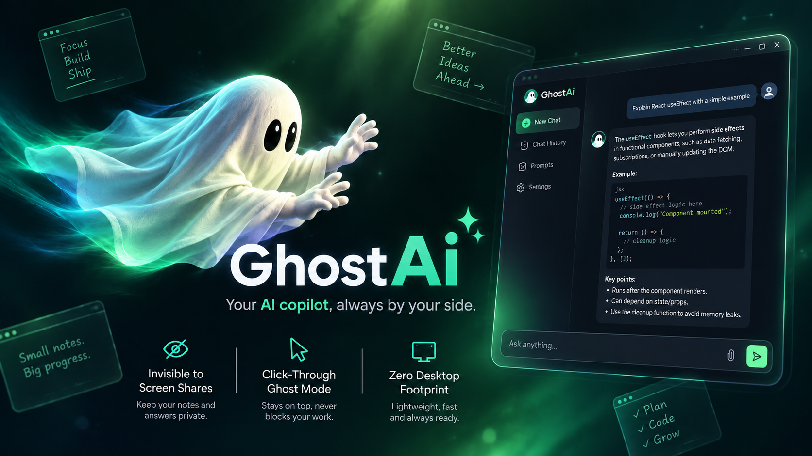

<div align="center">



# 👻 Ghost AI

### Your private, lightweight AI workspace companion.

**Less clutter. More focus. AI on your terms.**

A discreet desktop AI assistant for quick answers, coding help, research, and everyday productivity — with a floating interface, multi-provider support, and a workspace designed to stay out of your way.

<br>

[](LICENSE)
[](https://www.python.org/)
[](https://doc.qt.io/qtforpython/)
[](#platform-support)

</div>

---

## ✨ Why Ghost AI?

Ghost AI brings an AI chat window into your desktop workflow without making you switch constantly between applications. Keep it nearby when you need it, move it out of the way when you don't, and choose the AI provider that fits your needs.

- **💬 Streaming AI responses** — see answers arrive as the model generates them.
- **🗝️ Bring your own key** — configure supported cloud providers or compatible local model servers.
- **🗂️ Multi-chat history** — revisit, search, rename, and manage conversations.
- **👻 Floating, frameless interface** — a compact desktop companion designed to reduce visual clutter.
- **🫥 Ghost Mode** — toggle click-through behavior so clicks can pass to the application underneath.
- **🖥️ Capture-exclusion support** — uses operating-system features intended to exclude the app window from supported screen-capture paths. Behavior depends on OS, capture method, and application; do not treat this as a security boundary.
- **⌨️ Keyboard shortcuts** — use common actions without navigating through menus.
- **🎨 Customizable AI setup** — configure provider, model, endpoint, and API key in Settings.

> **Privacy note:** Ghost AI is a desktop client, not a guarantee of end-to-end privacy. When you use a cloud provider, the prompts and context you send are processed by that provider under its policies. Review the provider's terms and avoid sending secrets or sensitive information. Local providers such as Ollama can keep inference on your machine when configured to use a local endpoint.

## 🖼️ Preview

The repository preview image is shown at the top of this README. Add more screenshots to `images/` and link them here as the interface evolves.

## 🚀 Getting started

### Requirements

- Python 3.10 or newer
- Windows 10/11 or a supported macOS version
- An internet connection for cloud AI providers
- An API key for the cloud provider you choose, or a running local model server

### 1. Clone the repository

```bash
git clone https://github.com/Anoop-Kumar-31/Ghost-AI.git
cd Ghost-AI
```

### 2. Create and activate a virtual environment (recommended)

**Windows PowerShell**

```powershell
py -m venv .venv
.\.venv\Scripts\Activate.ps1
```

**macOS**

```bash
python3 -m venv .venv
source .venv/bin/activate
```

### 3. Install dependencies

```bash
python -m pip install --upgrade pip
pip install -r requirements.txt
```

### 4. Launch Ghost AI

```bash
python main.py
```

On Windows, `GhostAI.vbs` is also provided for launching without keeping a console window open.

## ⚙️ Configure an AI provider

1. Launch Ghost AI.
2. Open **Settings** from the app header, or press `Ctrl + ,`.
3. Choose a provider.
4. Enter your API key and model ID, and set a base URL if the provider requires one.
5. Use **Test** to verify the connection, then save your settings.

Ghost AI supports the provider configurations currently available in the application. Typical endpoints include:

| Provider | Base endpoint |
|---|---|
| OpenAI | `https://api.openai.com/v1` |
| OpenRouter | `https://openrouter.ai/api/v1` |
| Groq | `https://api.groq.com/openai/v1` |
| DeepSeek | `https://api.deepseek.com` |
| Ollama (local) | `http://localhost:11434/v1` |
| Custom OpenAI-compatible API | Set the endpoint provided by your service |

Provider availability, model names, pricing, and limits can change. Check each provider's current documentation and enter a model ID supported by both the provider and the app. Anthropic uses a different API format; use the app's provider-specific configuration rather than assuming every provider accepts the OpenAI-compatible endpoint.

### 🆓 Trying free models

Some providers offer free model tiers or limited free models, but availability and quotas change frequently. For example, OpenRouter lists models with free variants in its model catalogue.

1. Visit [OpenRouter's model catalogue](https://openrouter.ai/models?max_price=0).
2. Check the model's current price, limits, and provider availability.
3. Create an API key at [OpenRouter API Keys](https://openrouter.ai/keys).
4. Select **OpenRouter** in Ghost AI and enter the key and exact model ID.
5. Test the connection before using the model.

A model labelled free may still have rate limits, temporary unavailability, or account-specific restrictions. A key limit is not the same thing as free credits. Check the provider's billing page before using paid models.

## ⌨️ Keyboard shortcuts

| Shortcut | Action |
|---|---|
| `Enter` | Send message |
| `Shift + Enter` | Insert a newline |
| `Ctrl + G` | Toggle Ghost Mode / click-through |
| `Ctrl + N` | Start a new chat |
| `Ctrl + H` or `Esc` | Return to Home / Chats |
| `Ctrl + ,` | Open Settings |
| `Ctrl + Q` | Close Ghost AI |

## 🧱 Project structure

```text
Ghost-AI/
├── ghost_ai/
│   ├── ai_service.py       # Provider requests and streamed AI responses
│   ├── chat_view.py        # Chat interface and message bubbles
│   ├── config.py           # Provider presets and configuration
│   ├── controls.py         # Floating window controls
│   ├── history_view.py     # Conversation history UI
│   ├── macos_utils.py      # macOS-specific window behavior
│   ├── main_window.py      # Main window and navigation
│   ├── persistence.py      # Local conversation/settings persistence
│   ├── platform_utils.py   # Platform-specific helpers
│   └── win32_utils.py      # Windows-specific window behavior
├── images/                 # Project screenshots and branding
├── tests/                  # Automated tests
├── GhostAI.vbs             # Optional Windows launcher
├── main.py                 # Application entry point
├── requirements.txt        # Python dependencies
└── README.md
```

## 🧪 Run the tests

```bash
python -m pytest tests -v
```

Tests and platform-specific behavior may differ across operating systems. Run the suite on the platforms you intend to support before publishing a release.

## 🔐 Privacy and security

- API keys are configured locally through Ghost AI's settings.
- Cloud AI providers receive the requests you send them; review their data handling policies.
- Never commit API keys, tokens, personal data, or local configuration files to the repository.
- Use local inference if you need prompts to remain on your own machine, and verify that the configured endpoint is actually local.
- Screen-capture exclusion is an OS feature with limitations; it cannot guarantee invisibility to every recording, capture, or monitoring tool.

## 🛠️ Troubleshooting

**The API test fails**
- Verify the provider, API key, endpoint, and exact model ID.
- Check whether the model is available to your account and whether you have quota or credits.
- Read the full provider error. HTTP `401` usually indicates authentication trouble; HTTP `429` can indicate rate limits or quota/billing limits.

**A free model stops responding**
- Check the provider's current free-tier limits and model availability.
- Try another currently available free model.
- Avoid assuming a `:free` model ID will remain available indefinitely.

**Ghost AI does not launch**
- Activate the virtual environment and reinstall requirements.
- Run `python main.py` from the project directory to see startup errors.
- Check the supported Python and OS versions.

## 🤝 Contributing

Issues, bug reports, ideas, and pull requests are welcome. When reporting a bug, include your OS, Python version, provider/model (never the API key), steps to reproduce, and the relevant error message.

## 📄 License

Ghost AI is licensed under the [Apache License 2.0](LICENSE).

---

<div align="center">

**Ghost AI** · Your workspace, with a little more room to think. 👻

</div>