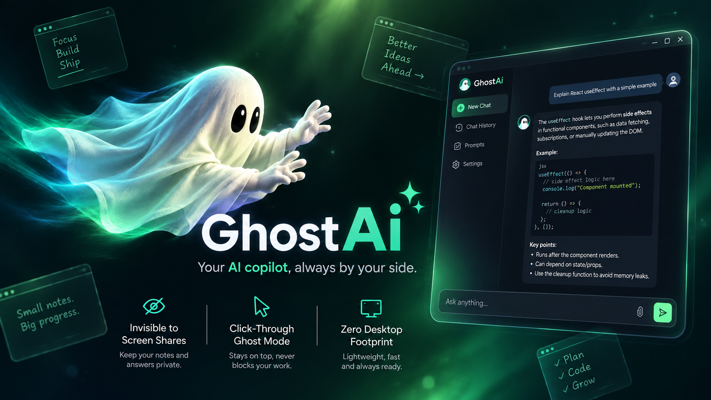

<div align="center">
  

  <h1>👻 Ghost AI</h1>

  <h3>Your private, lightweight AI workspace companion.</h3>

  <p><strong>Less clutter. More focus. AI on your terms.</strong></p>

  <p>
    A discreet desktop AI assistant for coding, research, quick answers, and everyday productivity.
    Keep it close when you need it, move it out of the way when you don't, and work with the AI provider
    that fits your workflow.
  </p>

  <p>
    <a href="https://github.com/Anoop-Kumar-31/Ghost-AI"></a>
    <a href="LICENSE"></a>
    
    
    
  </p>
</div>

---

## ✨ What is Ghost AI?

Ghost AI is a floating desktop AI workspace built with **Python and PySide6**. It gives you a compact chat interface that can stay above other windows, maintain multiple conversations, and connect to cloud or local AI services.

It is designed for people who want AI available during their normal desktop workflow without keeping a full browser tab open.

## 🚀 Features

### AI chat and model providers

- **Streaming responses** — watch responses arrive as the model generates them.
- **Multiple providers** — configure OpenAI, Anthropic, OpenRouter, Groq, DeepSeek, Ollama, or a custom OpenAI-compatible endpoint.
- **Bring your own API key** — use your own provider account and model ID.
- **Model configuration** — change the provider, model, endpoint, generation settings, and system prompt in Settings.
- **Local model support** — connect to a local Ollama server without sending prompts to a cloud inference provider.
- **Background workers** — network requests run outside the UI thread so the interface remains responsive.

### Microphone and system-audio transcription

Ghost AI includes two separate voice-to-text workflows. Both use **faster-whisper locally on your computer**; the captured audio is not sent to the configured chat provider for transcription.

- **🎙️ Microphone transcription** — record speech from your default microphone and convert it into text.
- **🔊 System-audio transcription** — capture audio from a supported loopback or virtual input device. This can be useful for transcribing the other side of a meeting or call.
- **Local Whisper model** — the current implementation loads the `tiny` faster-whisper model on the CPU using INT8 computation.
- **Review before sending** — the transcript is inserted into the chat composer. You can edit it before manually sending it to the selected AI provider.
- **Recording controls** — stop a recording to transcribe it, or cancel to discard the captured audio.
- **Recording limit** — recordings are capped at three minutes per capture.

**System-audio requirements:** Ghost AI needs an input device that exposes system output. Depending on your operating system and audio setup, this may be Stereo Mix, a loopback device, VB-CABLE, or BlackHole. These devices are not available by default on every computer. See [Voice setup](#-enable-voice-transcription) before using system-audio transcription.

### Desktop workspace

- **Floating, frameless window** — a compact, translucent interface designed to stay out of your way.
- **Always-on-top behavior** — keep the assistant above other windows during your workflow.
- **Ghost Mode / click-through** — toggle whether mouse clicks pass through the assistant window to the application underneath.
- **Capture-exclusion support** — uses native Windows/macOS window APIs where available to request exclusion from supported capture paths.
- **Conversation tabs** — keep multiple chats open and switch between them.
- **Searchable chat history** — find, rename, open, and delete previous conversations.
- **Persistent workspace state** — preserve conversation data, open tabs, window geometry, and selected view.
- **File attachments** — attach supported text and source-code files to a prompt.
- **Markdown rendering** — render headings, lists, tables, and formatted responses.
- **Syntax highlighting** — highlight fenced code blocks with Pygments.
- **Keyboard shortcuts** — navigate common actions without relying on menus.

> **Important:** Ghost Mode and capture exclusion are convenience features, not security or privacy boundaries. Their behavior depends on the operating system, OS version, recording method, and the application doing the capture. They cannot guarantee that Ghost AI will be invisible to every screenshot, screen recorder, monitoring tool, or remote-desktop application.

## 🖼️ Preview

The main application preview is shown at the top of this README. Additional screenshots can be added to the [`images/`](./images) directory as the interface evolves.

## 🧰 Technology stack

| Area | Technologies |
|---|---|
| Desktop UI | Python, PySide6, Qt |
| AI requests | `requests`, provider-specific HTTP APIs |
| Streaming and concurrency | Qt `QThread`, signals, background workers |
| Markdown | `markdown-it-py` |
| Code highlighting | Pygments |
| Voice capture | `sounddevice`, NumPy |
| Speech recognition | `faster-whisper` (Whisper `tiny`, CPU/INT8) |
| Credential storage | Python `keyring` with the operating system credential manager |
| Chat-history encryption | Fernet from `cryptography` |
| Platform integration | Windows Win32 APIs, macOS Cocoa APIs |

## 🤖 Supported AI providers

The application currently defines the following provider configurations:

| Provider | API type | Default/base endpoint |
|---|---|---|
| OpenAI | OpenAI-compatible | `https://api.openai.com/v1` |
| Anthropic | Anthropic Messages API | `https://api.anthropic.com` |
| OpenRouter | OpenAI-compatible | `https://openrouter.ai/api/v1` |
| Groq | OpenAI-compatible | `https://api.groq.com/openai/v1` |
| DeepSeek | OpenAI-compatible | `https://api.deepseek.com` |
| Ollama (Local) | OpenAI-compatible | `http://localhost:11434/v1` |
| Custom (OpenAI-Compatible) | OpenAI-compatible | Set the endpoint for your service |

Model availability, model IDs, pricing, rate limits, and free-tier policies are controlled by the providers and can change. Use the exact model ID supported by your account and the selected provider. Anthropic uses a different API format from the OpenAI-compatible providers; select the Anthropic option rather than configuring it as an OpenAI-compatible service.

### Trying free models

Some providers and model gateways offer free or limited-use models. For example, OpenRouter provides a catalogue that can be filtered by price:

1. Open the [OpenRouter model catalogue](https://openrouter.ai/models?max_price=0).
2. Check the model's current price, context limits, provider availability, and rate limits.
3. Create a key from [OpenRouter API Keys](https://openrouter.ai/keys).
4. Select **OpenRouter** in Ghost AI and enter the key and exact model ID.
5. Use the connection test in Settings before starting a conversation.

A model marked free may still have rate limits, temporary unavailability, or account-specific restrictions. Confirm billing and limits with the provider before using a model.

## 💻 Platform support

| Platform | Status | Notes |
|---|---|---|
| Windows 10/11 | Primary target | Native click-through, taskbar behavior, and supported capture-exclusion APIs are implemented. |
| macOS | Supported implementation | Native Cocoa window behavior is implemented. Microphone and audio-device permissions may need to be granted in System Settings. |
| Linux | Limited / unverified | The Qt application may run where PySide6 is supported, but the current platform fallback does not implement native Ghost Mode or capture exclusion. |

Platform-specific behavior should be tested on the exact OS version and desktop environment you intend to use.

## 🚀 Getting started

### Requirements

- Python **3.10 or newer**.
- Windows 10/11 or a supported macOS version for the native desktop behavior.
- Internet access for cloud AI providers and package installation.
- An API key for a cloud provider, or a running local model server such as Ollama.

### 1. Clone the repository

```bash
git clone https://github.com/Anoop-Kumar-31/Ghost-AI.git
cd Ghost-AI
```

### 2. Create a virtual environment

**Windows PowerShell**

```powershell
py -m venv .venv
.\.venv\Scripts\Activate.ps1
```

**macOS**

```bash
python3 -m venv .venv
source .venv/bin/activate
```

### 3. Install the core dependencies

```bash
python -m pip install --upgrade pip
pip install -r requirements.txt
```

The current source also uses `cryptography` for encrypted chat history and `keyring` for persistent access to the OS credential manager. These packages are not listed in the current `requirements.txt`, so install them explicitly:

```bash
pip install cryptography keyring
```

**Credential-store note:** Make sure a working Windows Credential Manager or macOS Keychain backend is available to Python `keyring`. The application's fallback vault is memory-only; it is not suitable for retaining API keys or the chat-history encryption key across application restarts. Do not rely on encrypted history persistence until the OS credential backend is working.

### 4. Enable voice transcription (optional)

Voice features require additional audio and speech-recognition packages. They are not included in the core installation:

```bash
pip install -r requirements-voice.txt
```

The optional requirements install `sounddevice`, NumPy, and `faster-whisper`. The first transcription may take longer while the Whisper model is initialized and, if it is not already cached, downloaded.

#### Microphone transcription

1. Connect and select a working microphone in your operating system's audio settings.
2. Launch Ghost AI and open a conversation.
3. Select the microphone button in the composer to start recording.
4. Select the stop button when you are done.
5. Wait for local transcription. The transcript is inserted into the composer for review and editing.

Allow microphone access when Windows or macOS asks for permission.

#### System-audio transcription

System-audio capture depends on an input device that exposes the computer's speaker output. Ghost AI looks for devices with names commonly associated with loopback capture, Stereo Mix, virtual cables, or BlackHole.

- **Windows:** Enable **Stereo Mix** in the Sound control panel when your audio driver provides it. Otherwise, configure a virtual audio cable such as [VB-CABLE](https://vb-audio.com/Cable/).
- **macOS:** Install and configure a loopback device such as [BlackHole](https://github.com/ExistentialAudio/BlackHole), then make it available as an input device.
- **Other setups:** Ensure the loopback device appears as an input device to `sounddevice` before starting Ghost AI.

Then select the system-audio button in the composer, stop the capture when finished, and review the transcript. If no compatible device is found, system-audio transcription will report an error rather than silently recording another source.

**Audio privacy:** Audio transcription runs locally through faster-whisper. The resulting text is placed in the prompt composer; it is only sent to your configured AI provider when you choose to send that message. Obtain appropriate consent before recording or transcribing other people's conversations, and follow applicable laws and meeting policies.

### 5. Launch Ghost AI

```bash
python main.py
```

On Windows, [`GhostAI.vbs`](./GhostAI.vbs) is also provided as an optional launcher that starts the application without leaving a console window open.

## ⚙️ Configure an AI provider

1. Launch Ghost AI.
2. Open **Settings** from the application header, or press `Ctrl + ,`.
3. Choose a provider.
4. Enter the API key and model ID. Adjust the base URL only when required by the selected service.
5. Use **Test** to verify the connection.
6. Save the settings.

Ghost AI validates endpoint URLs before sending credentials. Remote endpoints must use HTTPS. Plain HTTP is reserved for local loopback addresses such as `localhost` and `127.0.0.1`. Built-in providers are checked against their expected hostnames; an unrecognized custom endpoint requires explicit trust.

For Ollama, start the local server and make sure the selected model is available locally. The default endpoint is:

```text
http://localhost:11434/v1
```

## ⌨️ Keyboard shortcuts

| Shortcut | Action |
|---|---|
| `Enter` | Send the current message |
| `Shift + Enter` | Insert a new line |
| `Ctrl + G` | Toggle Ghost Mode / click-through |
| `Ctrl + N` | Create a new chat |
| `Ctrl + H` | Return to Home / chat history |
| `Ctrl + K` | Focus chat-history search |
| `Ctrl + ,` | Open Settings |
| `Ctrl + Q` | Close Ghost AI |

## 📎 File attachments

The composer can attach supported text and source-code files, including common formats such as `.txt`, `.md`, `.py`, `.js`, `.ts`, `.jsx`, `.tsx`, `.json`, `.html`, `.css`, `.c`, `.cpp`, `.h`, `.hpp`, `.rs`, `.go`, `.java`, `.xml`, `.yaml`, `.yml`, `.toml`, `.sh`, `.bat`, `.ps1`, `.sql`, and `.csv`.

Current attachment safeguards include an extension allowlist, a **1 MB per-file size limit**, and a limit on the amount of extracted text included in a prompt. Binary files, images, PDFs, and arbitrary file execution are not supported by this attachment flow.

## 🔐 Privacy and security

Ghost AI is a desktop client. It is not an end-to-end encrypted AI service and does not make cloud-provider processing private.

- **API keys:** Keys are stored separately from the JSON configuration file through Python `keyring` and the operating system's credential manager when a supported backend is available.
- **Chat history:** Conversation data is encrypted at rest using Fernet. The encryption key is stored through the credential manager. Keep the credential-store entry and its backups safe; losing the key can make the encrypted chat history unreadable.
- **Legacy data:** Older plaintext configuration and chat-history files may be migrated. The history migration can create a `.json.bak` plaintext backup; protect or securely remove that backup after confirming the migration.
- **Cloud providers:** Prompts, conversation context, attachments' extracted text, and any transcript you send are processed by the selected provider under its terms and privacy policy.
- **Local inference:** A local endpoint such as Ollama can keep model inference on your machine when it is genuinely bound to a local service. Verify the endpoint before sending private data.
- **Endpoint validation:** Remote endpoints require HTTPS; local HTTP is limited to loopback. Unrecognized custom hosts require explicit user trust.
- **Screen capture:** Capture exclusion is OS-dependent and cannot guarantee invisibility to every capture or monitoring method.
- **Voice:** Audio is transcribed locally in the current implementation. Review the transcript before sending it to a cloud provider.

Never commit API keys, access tokens, credential backups, private conversations, or local application data to the repository. Do not send secrets or sensitive information to an AI provider unless you understand and accept its data-handling policy.

## 🧪 Run the tests

Install the test runner:

```bash
pip install pytest
```

Run the suite from the repository root:

```bash
python -m pytest tests -v
```

The test suite includes coverage for:

- Chat-generation concurrency and multi-chat isolation.
- Markdown rendering and syntax highlighting.
- Chat-history persistence and geometry validation.
- Endpoint validation, credential handling, encrypted history, attachment safeguards, and voice cancellation.

On headless Linux/CI environments, Qt may need an offscreen platform plugin:

```bash
QT_QPA_PLATFORM=offscreen python -m pytest tests -v
```

Tests that depend on native window behavior, audio devices, or a desktop credential manager should also be exercised manually on the target operating system.

## 🧱 Project structure

```text
Ghost-AI/
├── assets/
│   └── icons/                   # SVG icons used by the desktop UI
├── ghost_ai/
│   ├── ai_service.py             # Provider APIs, streaming, and AI workers
│   ├── chat_view.py              # Chat interface, composer, attachments, voice controls
│   ├── config.py                 # Provider presets, settings, and endpoint validation
│   ├── controls.py               # Independent floating window controls
│   ├── header_bar.py             # Header, navigation, and conversation tabs
│   ├── history_view.py           # Searchable conversation history and home view
│   ├── icon_manager.py           # SVG icon loading, recoloring, and caching
│   ├── macos_utils.py            # Native macOS window integration
│   ├── main_window.py            # Main window, navigation, shortcuts, and lifecycle
│   ├── markdown_renderer.py      # Markdown parsing and Pygments highlighting
│   ├── persistence.py            # Encrypted chat-history persistence
│   ├── platform_utils.py         # Cross-platform native-feature dispatch
│   ├── secure_store.py           # OS credential storage and history key management
│   ├── settings_dialog.py        # Provider and model settings UI
│   ├── voice_worker.py           # Microphone and system-audio transcription workers
│   └── win32_utils.py            # Native Windows window integration
├── images/                       # Screenshots and project branding
├── tests/
│   ├── conftest.py               # Shared pytest fixtures
│   ├── test_chat_concurrency.py  # Multi-chat generation tests
│   ├── test_markdown_renderer.py # Markdown renderer tests
│   ├── test_persistence.py       # Persistence and geometry tests
│   └── test_security_hardening.py # Security and input-hardening tests
├── GhostAI.vbs                   # Optional Windows launcher
├── LICENSE                       # Apache License 2.0
├── main.py                       # Application entry point
├── requirements.txt              # Core application dependencies
├── requirements-voice.txt        # Optional audio/transcription dependencies
└── README.md
```

## 🛠️ Troubleshooting

### Ghost AI does not launch

- Activate the virtual environment before installing or running the application.
- Install the core dependencies and the additional `cryptography` and `keyring` packages.
- Run `python main.py` from the repository directory to see startup errors.
- Check that your Python and operating-system versions are supported.

### Chat history cannot be decrypted

- Check that the OS credential manager is available to Python `keyring`.
- Do not delete or reset the Ghost AI history encryption-key entry in the credential manager.
- Restore the matching credential-store entry and chat-history backup together when recovering data.
- Do not replace an unreadable encrypted history file with a new empty file; preserve a copy before troubleshooting.

### API connection test fails

- Verify the selected provider, API key, base URL, and exact model ID.
- Confirm that the model is enabled for your account and that the account has quota or billing access.
- Check that a remote endpoint uses HTTPS and that a custom host has been trusted.
- HTTP `401` commonly indicates an authentication problem. HTTP `429` can indicate rate limits or quota/billing limits.

### Microphone transcription does not work

- Install the optional voice dependencies with `pip install -r requirements-voice.txt`.
- Check that the operating system has granted microphone access.
- Confirm that the correct microphone is selected as the default input device.
- Check the application logs and the audio device configuration.

### System audio cannot be detected

- Confirm that Stereo Mix, a loopback input, VB-CABLE, or BlackHole is installed and enabled.
- Confirm that the device appears as an input device to PortAudio / `sounddevice`.
- On Windows, enable Stereo Mix in the Recording devices panel when your driver provides it, or configure a virtual audio cable.
- On macOS, check the BlackHole aggregate/multi-output setup and system audio permissions.

### A free model stops responding

- Check the provider's current free-tier limits and model availability.
- Try another model that is currently available to your account.
- Do not assume that a `:free` model ID or free quota will remain available indefinitely.

## 🤝 Contributing

Issues, bug reports, feature requests, and pull requests are welcome.

When reporting a bug, include:

- Operating system and version.
- Python version.
- Ghost AI version or commit.
- Provider and model name (never include your API key).
- Steps to reproduce and the relevant error or log output.

Please avoid attaching private chat histories, audio recordings, API keys, or other sensitive data to public issues.

## 📄 License

Ghost AI is licensed under the [Apache License 2.0](./LICENSE).

---

<div align="center">
  <strong>Ghost AI</strong> · Your workspace, with a little more room to think. 👻
</div>
